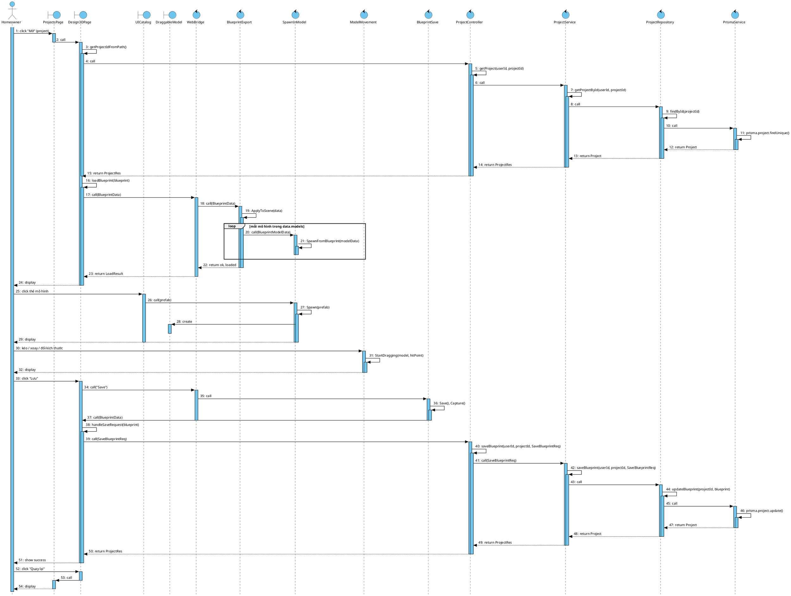

2.4.1.2. Thiết kế phối cảnh 3D

Kịch bản cho chức năng thiết kế phối cảnh 3D:

1. Chủ nhà (Homeowner) nhấn nút "Mở" trên một dự án trong danh sách tại ProjectsPage.
2. ProjectsPage gọi mở giao diện Design3DPage theo mã dự án đã chọn (đường dẫn /design/:projectId).
3. Design3DPage thực thi hàm getProjectIdFromPath() để lấy mã dự án (projectId) từ đường dẫn.
4. Design3DPage gửi yêu cầu tải dự án tới ProjectController.
5. ProjectController thực thi hàm getProject(userId, projectId) để tiếp nhận mã người dùng và mã dự án.
6. ProjectController chuyển yêu cầu sang ProjectService.
7. ProjectService thực thi hàm getProjectById(userId, projectId) để kiểm tra quyền sở hữu và điều phối lấy dự án.
8. ProjectService gọi tầng truy vấn ProjectRepository.
9. ProjectRepository thực thi hàm findById(projectId) để chuẩn bị truy vấn cơ sở dữ liệu.
10. ProjectRepository gọi sang PrismaService.
11. PrismaService thực thi truy vấn prisma.project.findUnique() trên bảng projects trong PostgreSQL.
12. PrismaService trả về đối tượng project: Project (kèm bản thiết kế blueprint dạng JSON) cho ProjectRepository.
13. ProjectRepository trả về project: Project cho ProjectService.
14. ProjectService trả về res: ProjectRes cho ProjectController.
15. ProjectController trả về res: ProjectRes cho Design3DPage.
16. Design3DPage khởi tạo trình thiết kế Unity WebGL (createUnityInstance) và khi trình thiết kế báo sẵn sàng, thực thi hàm loadBlueprint(blueprint) để gửi bản thiết kế đã lưu (dự án chưa có bản thiết kế thì dùng bản thiết kế trống).
17. Design3DPage gửi blueprint: BlueprintData dạng JSON sang WebBridge.
18. WebBridge tiếp nhận qua hàm LoadBlueprint(json), kiểm tra tính hợp lệ và chuyển data: BlueprintData sang BlueprintExport.
19. BlueprintExport thực thi hàm ApplyToScene(data) để xóa môi trường 3D hiện tại và dựng lại ranh giới thửa đất đã lưu.
20. Với mỗi mô hình trong bản thiết kế, BlueprintExport gửi modelData: BlueprintModelData sang SpawnInModel.
21. SpawnInModel thực thi hàm SpawnFromBlueprint(modelData) để tìm mô hình gốc theo prefabId và dựng lại mô hình tại đúng vị trí, góc xoay, tỉ lệ, trạng thái khóa và giá đã lưu.
22. BlueprintExport trả về kết quả ok và số mô hình nạp được (loaded) cho WebBridge.
23. WebBridge trả về kết quả nạp LoadResult (ok, loaded, total) cho Design3DPage.
24. Design3DPage hiển thị giao diện trình thiết kế 3D cho Homeowner: môi trường 3D với các mô hình tại vị trí đã sắp xếp trước đó, thanh công cụ (Di chuyển, Xoay, Thay đổi kích thước, Xóa, Lưu), thư viện mô hình phân theo danh mục và bảng dự toán kinh phí.
25. Homeowner chọn danh mục và nhấn vào thẻ mô hình muốn thêm trên UICatalog.
26. UICatalog chuyển prefab của mô hình đã chọn sang SpawnInModel.
27. SpawnInModel thực thi hàm Spawn(prefab) để tính vị trí sinh mô hình (ưu tiên khoảng trống gần nhất bên trong thửa đất) và căn mô hình sát mặt đất.
28. SpawnInModel khởi tạo DraggableModel mới trong môi trường 3D.
29. SpawnInModel hiển thị mô hình mới đang được chọn cho Homeowner. Homeowner lặp lại các bước 25 đến 29 cho mỗi mô hình muốn thêm.
30. Homeowner kéo thả mô hình đến vị trí mong muốn (hoặc dùng công cụ Xoay, Thay đổi kích thước) trong môi trường 3D.
31. ModelMovement thực thi hàm StartDragging(model, hitPoint) để di chuyển mô hình theo con trỏ chuột trên mặt đất.
32. ModelMovement hiển thị mô hình tại vị trí mới cho Homeowner.
33. Homeowner nhấn nút "Lưu" trên thanh công cụ của Design3DPage.
34. Design3DPage gửi lệnh "Save" sang WebBridge.
35. WebBridge chuyển yêu cầu lưu sang BlueprintSave.
36. BlueprintSave thực thi hàm Save() và Capture() để tổng hợp toàn bộ mô hình trong môi trường 3D (prefabId, vị trí, góc xoay, tỉ lệ, trạng thái khóa, giá, loại, hướng) cùng ranh giới thửa đất thành một bản thiết kế.
37. BlueprintSave gửi blueprint: BlueprintData dạng JSON sang Design3DPage.
38. Design3DPage thực thi hàm handleSaveRequest(blueprint) để kiểm tra dữ liệu bản thiết kế và tạo yêu cầu lưu khớp kiểu SaveBlueprintReq.
39. Design3DPage gửi req: SaveBlueprintReq sang ProjectController.
40. ProjectController thực thi hàm saveBlueprint(userId, projectId, req: SaveBlueprintReq) để kiểm tra hợp lệ dữ liệu đầu vào.
41. ProjectController chuyển req: SaveBlueprintReq sang ProjectService.
42. ProjectService thực thi hàm saveBlueprint(userId, projectId, req: SaveBlueprintReq) để kiểm tra quyền sở hữu dự án và điều phối lưu bản thiết kế.
43. ProjectService gọi sang ProjectRepository.
44. ProjectRepository thực thi hàm updateBlueprint(projectId, blueprint) để chuẩn bị cập nhật bản ghi.
45. ProjectRepository gọi sang PrismaService.
46. PrismaService thực thi lệnh prisma.project.update() để cập nhật bản thiết kế và thời điểm cập nhật của dự án trong PostgreSQL.
47. PrismaService trả về đối tượng project: Project đã cập nhật cho ProjectRepository.
48. ProjectRepository trả về project: Project cho ProjectService.
49. ProjectService trả về res: ProjectRes cho ProjectController.
50. ProjectController trả về res: ProjectRes cho Design3DPage.
51. Design3DPage cập nhật thời điểm lưu gần nhất và hiển thị thông báo "Đã lưu bản thiết kế" cho Homeowner.
52. Sau khi hoàn thành chỉnh sửa, Homeowner nhấn nút "Quay lại" trên thanh công cụ của Design3DPage để thoát khỏi môi trường 3D.
53. Design3DPage đóng trình thiết kế 3D và gọi mở giao diện ProjectsPage.
54. ProjectsPage hiển thị giao diện danh sách dự án cho Homeowner.

Mã PlantUML (cũng có trong tệp so-do-tuan-tu-thiet-ke-3d.puml):

